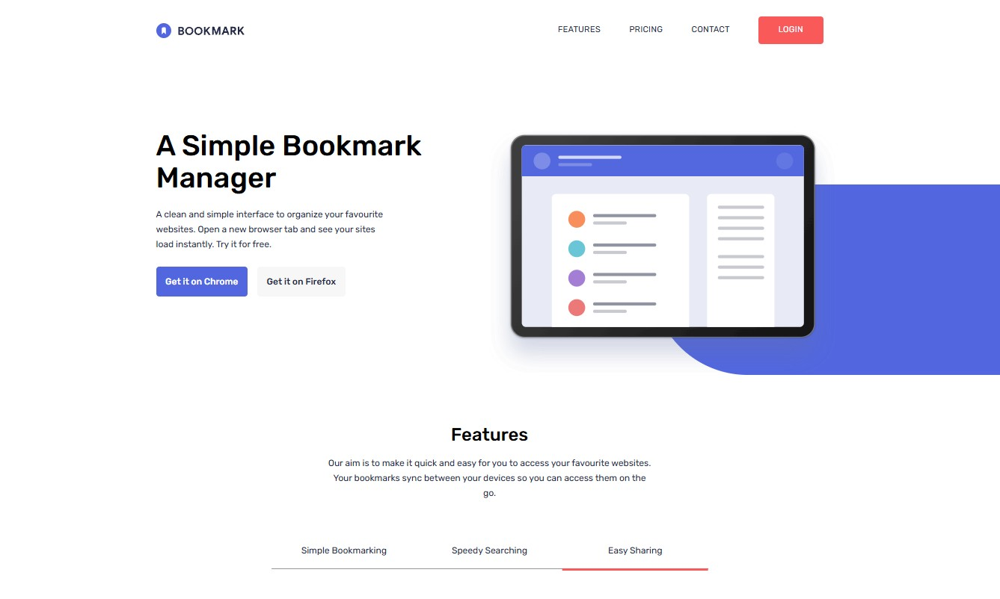

# Frontend Mentor - Bookmark landing page solution

This is a solution to the [Bookmark landing page challenge on Frontend Mentor](https://www.frontendmentor.io/challenges/bookmark-landing-page-5d0b588a9edda32581d29158).

## Table of contents

- [Overview](#overview)
  - [The challenge](#the-challenge)
  - [Screenshot](#screenshot)
  - [Links](#links)
- [My process](#my-process)
  - [Built with](#built-with)
  - [What I learned](#what-i-learned)
  - [Layout calculations and percentages](#layout-calculations-and-percentages)
  - [Continued development](#continued-development)
  - [Useful resources](#useful-resources)
  - [AI collaboration](#ai-collaboration)
- [Local development](#local-development)
- [Deployment](#deployment)
- [Author](#author)

## Overview

### The challenge

Users can:

- View responsive layouts for mobile, tablet, and desktop screens.
- Open and close the mobile navigation menu, including with the Escape key.
- Switch between feature panels and see the selected feature underlined.
- Expand FAQ answers.
- See hover states on links, buttons, and footer social icons.
- Receive inline feedback when submitting an empty or incorrectly formatted email address.

The contact form validates email syntax locally. It does not send emails or create subscriptions. Download, login, and social links are demonstration links.

### Screenshot



### Links

- Repository: [jonghwascript/bookmark-landing-page](https://github.com/jonghwascript/bookmark-landing-page)
- Deployment URL (available after the first successful deployment): [Bookmark landing page](https://jonghwascript.github.io/bookmark-landing-page/)

## My process

### Built with

- Semantic HTML
- Tailwind CSS v4, custom properties, and component styles
- Flexbox and a mobile-first responsive layout
- Vanilla JavaScript
- Vite v8
- ESLint and Prettier
- GitHub Actions and GitHub Pages

### What I learned

Design measurements can be translated into layout relationships. At a viewport width of 375px, 32px side padding leaves 311px for content. Cards can fill the available space while keeping a maximum width of 280px.

Feature selection uses `aria-current` to keep the visible panel and underline in sync. Email validation uses the input's native validity state with a custom error message, `aria-invalid`, and an alert for assistive technology.

Units also depend on context: moving a `20em` width from a 15px input to a 16px wrapper changes it from 300px to 320px. Using `18.75rem` for the wrapper preserves the intended 300px width at the default root font size and keeps the tablet form within its 442px container.

### Layout calculations and percentages

`calc()` combines lengths and arithmetic. A percentage takes its reference from the property where it is used; it does not always refer to the viewport. `100vw` explicitly means the full viewport width. Tailwind arbitrary values use underscores for spaces, so `calc(50%_-_0.5rem)` becomes `calc(50% - 0.5rem)`.

#### Container limits and desktop alignment

```css
width: min(100%, 1275px);
padding-left: calc(max(0px, (100% - 1275px) / 2) + 80px);
```

The page container fills its containing block up to 1275px and is centered with automatic inline margins. The desktop hero padding reproduces that container's left edge plus an 80px inset. Here, the padding percentage refers to the containing block's width.

With a 1440px containing block, the padding is `(1440 - 1275) / 2 + 80 = 162.5px`. Below 1275px, `max(0px, ...)` prevents a negative outer offset, leaving 80px of padding. This rule applies only at the `lg` breakpoint.

#### Mobile menu padding

```css
padding-inline: calc((100vw - 82vw) / 2);
```

The menu reserves 82% of the viewport width for content and splits the remaining 18% between its sides. Each side receives `9vw`, or 33.75px at a 375px viewport. This is viewport-relative spacing rather than a fixed 32px gutter.

#### Feature image proportions and spacing

```css
aspect-ratio: 536 / 416;
margin-bottom: calc(100% * 416 / 536 * 0.16);
```

The visual's aspect ratio means its height is its width multiplied by `416 / 536`. The margin formula reserves 16% of that calculated height when the visual fills the containing block's width. For a 311px containing block, this is `311 * 416 / 536 * 0.16`, approximately 38.62px.

Vertical percentage margins also use the containing block's **width**. Once the visual is capped at 536px on larger screens, the margin is still calculated from its containing block, so it is not necessarily 16% of the visual's actual height. The desktop markup resets this margin with `lg:mb-0`.

#### Decorative backgrounds

| Values | Reference and effect |
| --- | --- |
| Hero `before:w-[76%]` and `before:h-[78%]` | The absolute background uses 76% of the positioned wrapper's width and 78% of its height, anchored to the bottom right. |
| Feature `top-[17%]` and `h-[99%]` | The absolute background starts 17% down the visual's height and is 99% as tall as the visual. Its bottom reaches 116% of the visual's height, extending below it. |
| Hero `lg:basis-[52%]` and `lg:basis-[48%]` | The image and text receive initial flex bases relative to the flex container's inner main size. Flex growth, shrinking, and size constraints can change their final widths. |

These percentages control the illustration layout and decorative shapes. Their presence in the implementation does not establish that Figma specifies the same responsive ratios.

```css
margin-left: calc((100% - 100vw) / 2);
/* At viewport widths of 768px and above: */
margin-left: calc(100% - 100vw);
```

These negative margins extend the feature background toward the viewport's left edge. Here, `100%` uses the visual containing block's width. With a 311px visual and a 375px viewport, the first formula gives `(311 - 375) / 2 = -32px`, canceling a centered 32px gutter. The second formula uses the entire width difference; reaching the viewport edge then depends on the visual's actual horizontal position.

#### Feature underline sizing and centering

```css
width: min(100%, calc(163 / 375 * 100vw));
left: 50%;
translate: -50% 0;
```

The underline is 163px wide at a 375px viewport, preserving a viewport ratio of approximately 43.47%. `min()` caps it at the link's width. `left: 50%` positions its left edge halfway across the containing link, while the negative translation moves it back by half of its **own** width to center it.

The FAQ arrow uses the same centering principle vertically. Its usual `top: 50%` refers to the summary's height, while `-translate-y-1/2` moves it up by half of the arrow's own height. For the first mobile question, `top: calc(50% - 0.5rem)` compensates for the removed top padding; `0.5rem` is 8px at the default 16px root font size.

### Continued development

- Add browser coverage for keyboard navigation and responsive behavior.
- Check layouts with longer content and increased text size.
- Connect the contact form to a subscription service if this becomes a production site.

### Useful resources

- [Vite deployment guide](https://vite.dev/guide/static-deploy.html#github-pages) — configuring the project base path and GitHub Pages deployment.
- [Tailwind CSS documentation](https://tailwindcss.com/docs) — utility classes, responsive variants, and custom component styles.

### AI collaboration

Codex assisted with layout analysis, hover states, email validation and error styling, debugging the tablet form width, and deployment configuration. Changes were reviewed against the project code and checked with production builds.

## Local development

Use Node.js 22.12 or later in the Node.js 22 release line, matching the deployment workflow.

```sh
npm ci
npm run dev
```

Open the local URL printed by Vite, including the `/bookmark-landing-page/` base path.

```sh
npm run build
npm run preview
```

The production build is generated in `dist/`. Additional commands:

```sh
npm run lint
npm run format:check
```

## Deployment

The workflow in [`.github/workflows/deploy.yml`](.github/workflows/deploy.yml) installs locked dependencies, builds the site, and deploys `dist/` to GitHub Pages on pushes to `main`. It can also be run manually from the Actions tab.

1. Push these files to the GitHub repository.
2. Open **Settings → Pages → Build and deployment** and set **Source** to **GitHub Actions**.
3. Open **Actions → Deploy to GitHub Pages** and run the workflow, or push another commit to `main`.
4. After deployment succeeds, open the deployment URL listed above.

The Vite `base` is `/bookmark-landing-page/`. Update it and the deployment URL if the repository name or hosting path changes. No personal access token or custom deployment secret is required; the workflow uses `GITHUB_TOKEN` with Pages deployment permissions.

## Author

- GitHub — [@jonghwascript](https://github.com/jonghwascript)
- Frontend Mentor — [@jonghwascript](https://www.frontendmentor.io/profile/jonghwascript)
